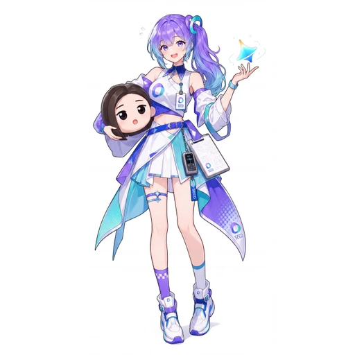

# Seed／豆包 · 同人形象与品牌头像分开

[人物总表](README.md) · [来源台账](../research/2026-10-24/SOURCE_LEDGER.md)

## 本页选用的形象

沿用本库已有 ZipZipPipe p10／第 11 张的 Seed／豆包同人归档：紫蓝发束／单马尾、蓝白科技运动风裙装、SEED 配饰及玩偶。它与豆包官方的短发女性头像不是同一套全身设计。[A02、R02、R03]

若任务明确要官方头像，应另找对应品牌资料；不把网友补画的全身和三视图称作官方发布。这是资料分层，不影响用户自由选用不同同人版本。

## 必须保留的索引冲突

shuaizenge 固定版本将 p10 标成 Gemini 变体；SelinLee 的固定 manifest 则把同一原始文件归为 zipzippipe-doubao，选定页为 11。两边涉及的原图 SHA-256 为 `a923dd580c161ecb0f869b8c0457deaece480a74d0f0f00e4abadf55521d99ce`。[R01、R02]

本库沿用 SEED 对应的归档判断，并把原始冲突公开保存。本轮 Pixiv 全页不可达，没有将其表述为刚取得作者逐页文字确认，也没有删掉冲突的一方来制造“无争议”。

## 社区认识与关系

“豆包、Seed、豆姐”需结合画面和上下文；“豆姐”在相关创作者系列标题中出现，但不是确定年龄或与其他角色的姐姐关系。[C03 系列标题]

本轮没有足够依据给这套形象添加固定性格、家庭或恋爱关系。也不因蓝紫头发就合并到 Gemini。

## 用于设计的建议，不是原设

运动服和标记可形成更轻快的工作、招手姿态。先保留发束形状、服装剪裁与 SEED 识别物；额外加芽苗、换学生制服等属于新设计，不当作原作还原。

## 新增九人群像作品线索（2026-10-27）

[《九位 AI 娘化 world.execute(me);》（2026-10-13）](https://www.bilibili.com/video/BV1ARpZ6wEB7/) 与 [GPT-6 Astra 修订版（2026-10-14）](https://www.bilibili.com/video/BV1Qhpy6uE1s/) 的公开简介均列出“豆包”为九位登场形象之一，并列出素材来源（N18–N19）。本条只记录出场名称，不根据未逐帧核对的画面来裁决本档案既有的 Pixiv p10 标签冲突。

来源台账：[N18–N19](../research/2026-10-27/SOURCE_LEDGER.md)。
