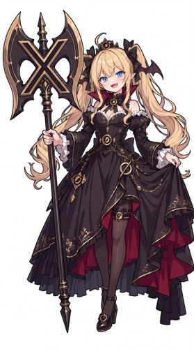

# Grok · 金发蝠翼与 X 巨斧

[人物总表](README.md) · [来源台账](../research/2026-10-24/SOURCE_LEDGER.md)

## 来源与外观

ZipZipPipe p07／第 8 张与原视频 29 秒样本：金色双马尾、黑色小蝠翼、黑红哥特裙、巨大 X 形斧；蓝色眼睛、金色边饰与头饰是样本细节。[A01、A02、R03、V01]

橙色机能外套、红橙头发、普通枪械配件并不是这一基准。X 斧不能仅替换成衣服上一个小 X；蝠翼也不能被画成 GPT 的浅紫大膜翼。

## 社区认识

Grok 娘、蝠翼形象是本库可直接定位的识别信息。网上“毒舌、反叛、搜片”等词混合现实产品评价、成人话题和不同作者演绎，本轮证据不足以写成这一形象的固定人格。[C18 仅为传播归纳，不作定论]

## 与其他角色

可见多位 AI 娘同框作品，也可见某作者以吃醋为题的系列。后者说明有这种二创，不说明 Grok 与任何角色有通用恋爱关系。[C07、C19]

## 用于设计的建议，不是原设

得意、挑眉、侧目或把斧柄支在身旁可形成不同表演。拿大型道具时先考虑双手或单手的支撑和重心；不能让整把斧头无重量地随身体浮动，也不必把每个状态都画成战斗。

## 待补

原作者完整性格、三视图、Q 版动作原件尚不足。用户选择其他明确同人版本时可以另建变体，不用将它们拼成一套主设。
