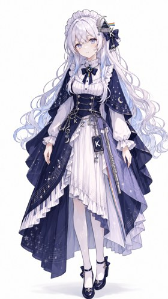

# Kimi · 银白发与夜蓝星月

[人物总表](README.md) · [来源台账](../research/2026-10-24/SOURCE_LEDGER.md)

## 来源与外观

ZipZipPipe p05／第 6 张。银白至淡紫长发、夜蓝与白色层叠裙装、显眼的 K 标记、月与星元素；视频 41 秒样本还有长笛、音符、由笛端延伸的彩色光带。[A02、R03、V01]

发色不是深蓝。她与 GPT 都有浅色长发，但没有 GPT 那套双龙角、浅紫膜翼和分段鳞尾。长笛是样本中实际出现的道具，不要因为“星月”就只画成拿书的泛用魔法师。

## 原作者换装：万圣节

ZipZipPipe 的 [《万圣节Kimi》](https://www.bilibili.com/opus/1264610067603259430)保留银发和夜蓝裙，新增毛绒耳尾、爪套、南瓜挂饰。画这套可以照图加耳尾；画基础夜蓝星月装时不要反套进去。[配图对照](../research/2026-11-22/VISUAL_ADDENDUM.md)

**独立桌宠变体：** [CrossPet v1.4.0](https://github.com/lokicorvus/crosspet/releases/tag/v1.4.0)把同一角色母题改成配月牙夹、持小提琴的桌宠，增加时段与节日立绘。小提琴来自此项目，不替换上文原视频里的长笛。

## 社区认识

Kimi 是清楚的模型名；星月和夜色是强视觉联想。“温柔、安静、文艺”等可以是阅读画面的印象，本轮没有把它们写成作者确认的统一人格。社区档案中的长笛／星空标签只能支持找图方向。[C21]

**新版本使用印象：** K3.1 Pro 的 Highspeed 讨论常把快慢与额度放在一起；有人接活很快就看到额度告警，也有人觉得速度并不快。可以把任务中看表、换挡写成情境，不固化为统一性格。[U04](../research/2026-11-22/COMMUNITY_USAGE.md#u04--kimi-highspeed速度期待与额度焦虑)

## 与其他角色

原视频属于共同角色集合，不由此推定与 GPT 是姐妹、与某人固定成对，或在某所学院有确定职位。关系证据不足部分留空。

## 用于设计的建议，不是原设

工作时可以收好长笛、专注倾听；待机可以轻抬笛、看向一侧或调整袖口。音乐道具可选用，不要在每一帧都重复同一吹奏站姿。星月表现应服务于人物，不淹没面部。

## 待补

没有本轮可确认的统一性格卡或跨作者固定关系；Q 版完整动作包未取得。

## 新增跨角色作品用例（2026-10-27）

- [《Fate/AGI dawn》OP1（2026-10-02）](https://www.bilibili.com/video/BV1xPam6ZEpc/)：作品简介将 Kimi 与 RWKV 同列 Assassin 阵营。这是该片自己的情节／角色配置（N07）。

来源台账：[N07](../research/2026-10-27/SOURCE_LEDGER.md)。
