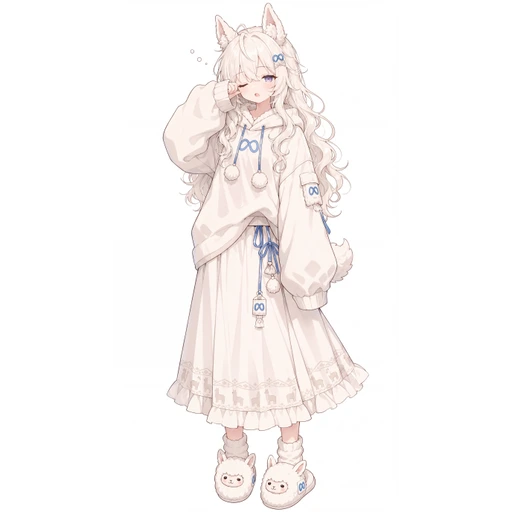

# Llama · 羊驼母题

[人物总表](README.md) · [来源台账](../research/2026-10-24/SOURCE_LEDGER.md)

## 来源与外观

本库沿用 ZipZipPipe《AI娘化》p13／第 14 张归档，p14 是同角色另一站姿的归档线索。浅银白长发、羊驼耳与小尾巴、宽松浅色外套／裙装、∞ 符号、羊驼造型鞋是已有素材索引明确记载的组合。[A02、R01、R03]

本轮没有重新取得原站全尺寸图；这页基于本库既存缩略图记录及固定版本的角色说明，不声称看到了新的三视图。

## 社区认识

Llama 与羊驼意象对应，是认图基础。不能因为泛用生成图画了兔耳就改成兔娘，也不采用某聚合站“白色猫耳”的简化标签。[R01；C22 为冲突对照]

“温顺、治愈、迷糊、开源家族大姐”等性格或家庭关系，本轮没有足够特定作品证据，暂不写成社区共识。

## 用于设计的建议，不是原设

可以从宽松衣袖和羊驼母题做柔和的待机、倾听、抬手反应，但不能让所有表情都一样。耳形、∞ 与鞋的母题比多挂几只毛绒玩偶更有辨识性。

## 待补

本轮参考视频的九人名单不含 Llama，不从那个视频编造她的时间码。Q 版原图、多视图及统一人格资料待补。既有预览只是技术缩图，不等于高清源文件。
