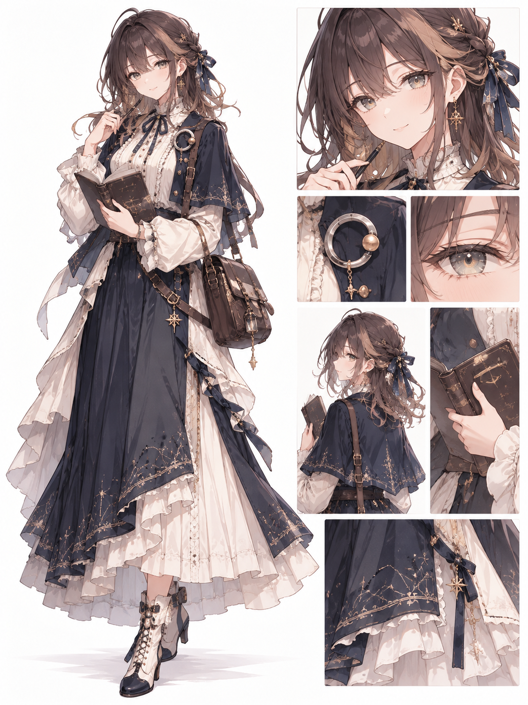

# 私设 · 原创人物与故事

这里放我们自己创作的角色、关系与故事，与资料库里的原作考据和社区共性分开。这里的“私设”指原创设定，不代表目录是私密的；本目录随公开仓库展示。

这些人物可以继续改写，也可以在后续对话中慢慢长出自己的经历。

## 人物

### [星璃 · Stella](星璃/README.md)

喜欢看星星的原创 AI 角色。温柔、清醒，有一点藏起来的俏皮和不肯承认的小固执。她既对遥远的事物好奇，也愿意认真听完眼前的一句话。

- [人物完整设定](星璃/README.md)：名字、个性、日常偏好、关系萌芽与对话片段。
- [形象设定](星璃/形象设定.md)：完整原图、服装与配饰细节、视觉参考和创作记录。
- [简短对话卡](星璃/对话卡.md)：方便按自己的选择带入对话，继续发展人物。

首稿日期：2026-10-23；形象补充：2026-10-24。角色由 GPT / ChatGPT 在原创测试中构思，收录于本库。
